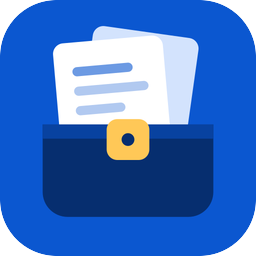
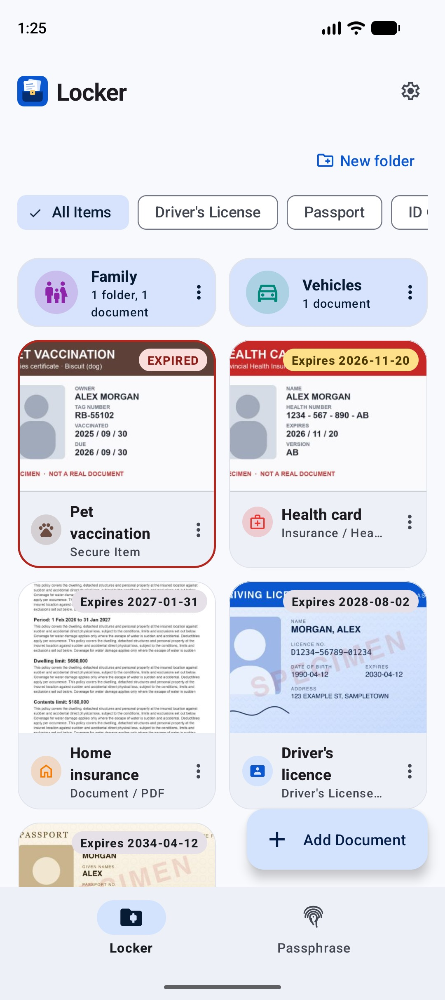
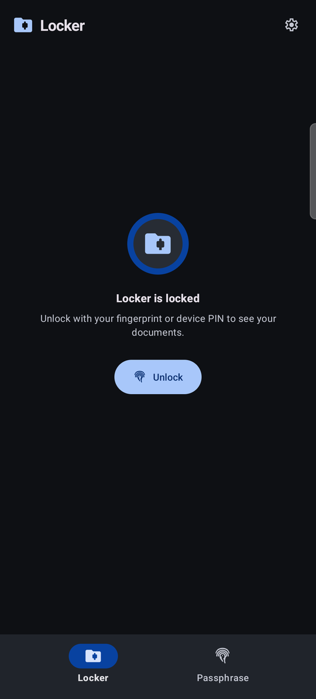
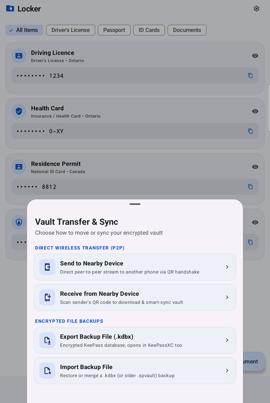
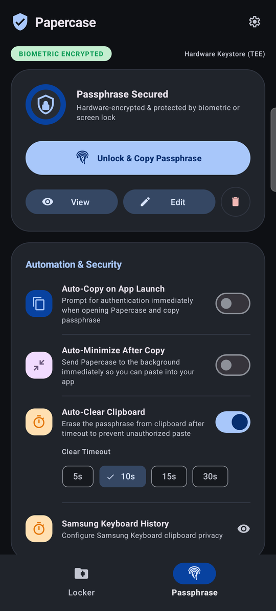

<p align="center">
  
</p>

<h1 align="center">Papercase</h1>

<p align="center"><b>A private, offline locker for your important documents on Android.</b></p>

<p align="center">
  <a href="https://github.com/mattintech/papercase/actions/workflows/ci.yml"></a>
  <a href="LICENSE"></a>
  
</p>

Keep your passport, driver's licence, health card and other papers on your phone, encrypted and locked behind your fingerprint. Move them between your own devices over Wi-Fi without any cloud service, and back them up to a file you can open in KeePass.

No accounts. No servers. No tracking. Your documents never leave your devices unless you send them.

<p align="center">
  
  &nbsp;
  
  &nbsp;
  
</p>

> **Status:** early development. It works on the devices it's been tested on (a Samsung Galaxy Z Fold7 and a Samsung Galaxy tablet), but expect rough edges. Keep a backup.

## What it does

**Locker**
- Store IDs, passports, licences, insurance cards and PDFs, with front/back photos, visas and extra pages.
- Everything is encrypted with a key held in your phone's secure hardware. The locker opens only after you unlock with your fingerprint or device PIN, and locks itself again when you leave.
- Give any document its own password for an extra layer.
- Crop photos to just the document: drag the corners and the page is straightened, even if it was photographed at an angle.
- Photos are cleaned of location, timestamps and camera details when you add them.
- Copy a document number with one tap; with auto-clear on, the clipboard is wiped after a few seconds.
- Get reminded before a document expires: choose how early on each one (a week to a year), and keep getting reminded every two weeks after it expires until you update it.

**Move documents between your devices**
- Show a QR code on one phone, scan it on the other, and the locker is sent directly over your local Wi-Fi.
- The sending phone shows which device is asking and must approve with fingerprint or PIN before anything is sent.
- Changes are merged: new documents are added, edits keep the newest version, and deletions carry over.

**Back up to a file**
- Export the locker as a standard **KeePass (.kdbx)** file, protected with a one-time token.
- The backup also opens in [KeePassXC](https://keepassxc.org/) or [KeePassDX](https://www.keepassdx.com/), so your data is never locked into this app.
- Or turn on automatic backups: daily or weekly, to a folder you choose (including a synced folder), protected with a backup password you set. The 5 most recent are kept.

**Passphrase**
- A secondary feature for people who use a long master passphrase (for example for a KeePass database): store it under your fingerprint and copy it with one tap, from the app or a Quick Settings tile. The clipboard is wiped after a timeout you choose.

<p align="center">
  
</p>

## How your data is protected

| | |
|---|---|
| **At rest** | AES-256-GCM, with the key in the Android Keystore (hardware-backed where available). The key can only be used within 10 minutes of a fingerprint or device-credential unlock. |
| **Screen lock** | Required to receive documents. If you remove your device's screen lock, Android destroys the key and the locker can't be opened, so keep a backup. |
| **Per-document passwords** | Attachments are encrypted with a key derived from that password. They stay encrypted in transfers and backups, and only open with the password. |
| **Phone-to-phone transfer** | Encrypted with a random 256-bit key that exists only in the QR code and is never sent over the network. The sender must approve the receiving device. |
| **Backups** | KeePass KDBX 4: AES-256 with Argon2id (64 MiB, 3 passes). The token is randomly generated. |
| **Network** | The app talks only to your other device on the local network, during a transfer you started. There are no analytics or crash reporting. (The Google Play version also asks the Play Store app whether an update is available.) |

Known limitations:
- For password-protected documents, only the attachments are encrypted with the document password; the title, number and notes are protected by the locker key only (and are readable in a backup by anyone with its token).
- Samsung Keyboard keeps its own clipboard history, which other apps can't clear. The app explains how to turn it off.

Papercase collects no data at all. See the [privacy policy](PRIVACY.md).

Found a security issue? Please don't open a public issue. See [Reporting security issues](CONTRIBUTING.md#reporting-security-issues).

## Install

Papercase isn't in an app store yet. F-Droid and Google Play releases are on the way; signed APKs will be attached to each [GitHub release](https://github.com/mattintech/papercase/releases).

To build it yourself:

```bash
git clone https://github.com/mattintech/papercase.git
cd papercase
./gradlew assembleFdroidDebug
adb install app/build/outputs/apk/fdroid/debug/app-fdroid-debug.apk
```

Requires Android 12 (API 31) or newer, and JDK 17+ to build.

### Builds

There are two flavors with the same app ID:

- **`fdroid`** contains no Google libraries and works on any Android 12+ device. This is the build on F-Droid and on the GitHub releases page.
- **`play`** is the Google Play build. It adds one thing: a prompt suggesting an update when Google Play has a newer version (never forced).

Debug builds install as a separate app, "Papercase Debug" (`com.mattintech.papercase.debug`), so they can sit next to the store version.

## Moving from SecurePass

Papercase was previously called SecurePass. It's a new app ID, so data doesn't carry over automatically. In SecurePass, export a backup file, then use **Import Backup File** in Papercase with the same token. Older `.spvault` backups import too.

## Contributing

Contributions are welcome. Please **open an issue first** to talk about what you'd like to change, then fork the repo and send a pull request to the `develop` branch. See [CONTRIBUTING.md](CONTRIBUTING.md).

## License

Papercase is free software, licensed under the [GNU General Public License v3.0](LICENSE).

KDBX support uses [kotpass](https://github.com/keemobile/kotpass) (Apache-2.0). Icons are from Google's [Material Symbols](https://fonts.google.com/icons) (Apache-2.0).
